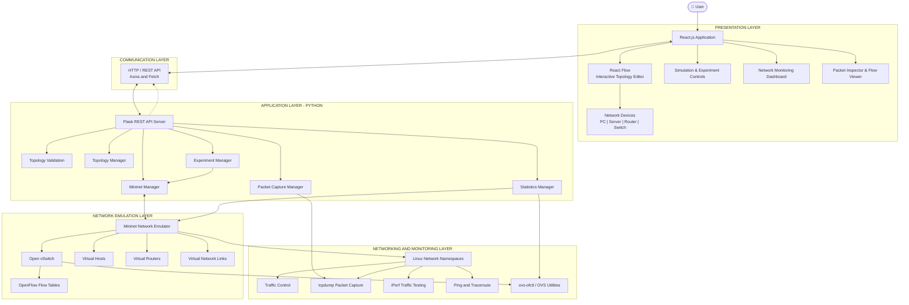
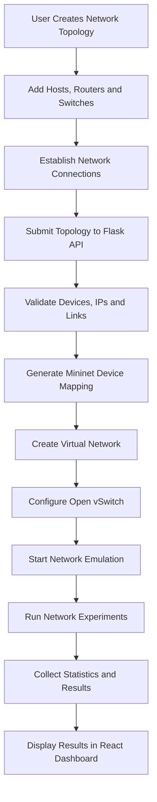
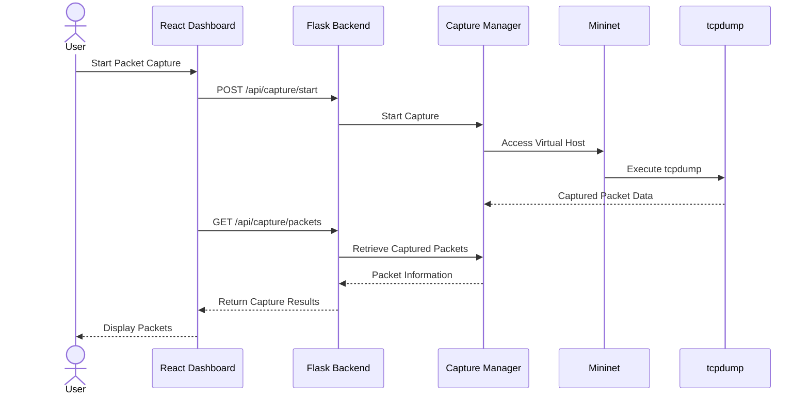

# 🌐 NetBuilder – Interactive Network Topology Simulator

<p align="center">
  <b>Design • Connect • Emulate • Monitor • Analyze</b>
</p>

<p align="center">
  A full-stack interactive network topology simulator powered by React, Flask, Mininet and Open vSwitch.
</p>

---

## 🚀 Overview

**NetBuilder** is an interactive network topology design and emulation platform that allows users to construct, configure, execute, and analyze computer networks through a visual interface.

Instead of limiting network design to static diagrams, NetBuilder connects a visual topology editor with a Python-based network emulation backend. Users can create network devices, establish links, launch network topologies, generate traffic, inspect packets, monitor network statistics, and experiment with network behavior.

The platform integrates **React Flow, Flask, Mininet, Open vSwitch (OVS), and Linux networking utilities** to provide a practical environment for exploring computer networking concepts.

## ✨ Key Features

### 1. Interactive Network Topology Editor
- Drag-and-drop network device placement.
- Create and remove connections between devices.
- Configure device properties and network parameters.
- Visualize network topology through an interactive canvas.
- Save and load topology configurations.
- Sample network templates for quick setup.

### 2. Network Emulation with Mininet
- Convert frontend network topologies into Mininet networks.
- Create virtual hosts, routers, switches, and links.
- Start, stop, and reset network environments.
- Validate network configurations before execution.
- Support simulated fallback mode when real Mininet is unavailable.

### 3. Network Connectivity Testing
- Execute ping tests between network devices.
- Perform bandwidth measurements using iPerf.
- Generate TCP and UDP traffic.
- Monitor connectivity and link status.
- Inspect network paths.

### 4. Traffic Generation and Experimentation
- Configure traffic generation parameters.
- Select source and destination nodes.
- Configure protocols, packet sizes, and transmission rates.
- Run network experiments with configurable durations.
- Maintain experiment history.
- Replay and compare experiments.

### 5. Link Failure and Network Conditions
- Enable and disable network links.
- Simulate link failures.
- Configure bandwidth limitations.
- Introduce network delay and packet loss.
- Configure queue sizes using traffic control.

### 6. Packet Inspection
- Start and stop packet captures.
- Inspect captured packets.
- Analyze captured protocol information.
- Retrieve individual packet details.
- Access packet capture data and PCAP information.

### 7. Routing and Traceroute
- Execute traceroute between network nodes.
- Inspect router routing tables.
- Add and delete routing entries.
- Analyze network paths and routing behavior.

### 8. OpenFlow and SDN Management
- Retrieve OpenFlow flow tables.
- Inspect switch information.
- Install flow rules into Open vSwitch switches.
- Configure match criteria, actions, and priorities.
- Explore Software-Defined Networking concepts.

### 9. Network Monitoring and Statistics
- Monitor transmitted and received packets.
- Inspect transmitted and received bytes.
- Track packet errors and dropped packets.
- Monitor switch port statistics.
- View network experiment metrics.

---

# 🏗️ System Architecture

NetBuilder follows a layered architecture connecting the frontend visualization system with a Python backend, network emulation engine, virtual switching infrastructure, and Linux networking environment.

## Complete System Architecture Diagram



## Architecture Layers Explained

| Layer | Technologies | Responsibility |
|---|---|---|
| Presentation | React.js, React Flow | Topology creation and visualization |
| Communication | HTTP, REST, Fetch, Axios | Frontend-to-backend requests |
| Application | Python, Flask | API handling and application logic |
| Topology Management | Python | Validation and device mapping |
| Network Emulation | Mininet | Virtual network construction and execution |
| Switching | Open vSwitch | Virtual switching and OpenFlow |
| Network Utilities | Linux, ping, iPerf, tcpdump | Connectivity, traffic and packet inspection |
| Monitoring | Statistics Manager | Network and switch statistics |

## Network Execution Workflow

The following diagram explains how a user-created topology becomes an executable network.



## Packet Capture and Monitoring Workflow



---

# 🛠️ Technology Stack

| Category | Technologies |
|---|---|
| Frontend | React.js, JavaScript |
| Network Visualization | React Flow |
| UI Components | Tailwind CSS, shadcn/ui |
| Charts | Recharts |
| Backend | Python, Flask |
| API Communication | REST API, Fetch, Axios |
| Network Emulation | Mininet |
| Virtual Switching | Open vSwitch |
| SDN Protocol | OpenFlow |
| Traffic Generation | iPerf |
| Packet Inspection | tcpdump |
| Network Testing | ping, traceroute |
| Network Configuration | Linux Traffic Control |
| Version Control | Git, GitHub |
| Development Environment | VS Code |

---

# 🧠 Core Backend Modules

The Python backend is divided into specialized modules.

| Module | File | Responsibility |
|---|---|---|
| API Server | `server.py` | Flask routes and request handling |
| Mininet Manager | `mininet_manager.py` | Network creation, execution and control |
| Topology Manager | `topology_manager.py` | Topology validation and device mapping |
| Statistics Manager | `stats_manager.py` | Host, switch and OpenFlow statistics |
| Experiment Manager | `experiment_manager.py` | Traffic experiments and experiment history |
| Capture Manager | `capture_manager.py` | Packet capture and inspection |

### 1. Topology Manager

Responsible for:
- Validating network devices.
- Checking device IDs and duplicate names.
- Validating IP address configurations.
- Checking connection source and destination devices.
- Detecting duplicate and invalid links.
- Generating Mininet device mappings.
- Finding paths within network topologies.

### 2. Mininet Manager

Responsible for:
- Starting and stopping virtual networks.
- Creating Mininet hosts, switches, routers and links.
- Managing virtual network interfaces.
- Executing connectivity tests.
- Running traffic and bandwidth tests.
- Managing link states.
- Interacting with Open vSwitch.

### 3. Experiment Manager

Responsible for:
- Validating experiment configurations.
- Managing source and destination nodes.
- Supporting TCP, UDP and ICMP experiment configurations.
- Configuring packet size, duration and transmission rate.
- Maintaining experiment history.
- Supporting experiment replay and comparison.

### 4. Capture Manager

Responsible for:
- Starting and stopping packet captures.
- Running tcpdump where available.
- Collecting packet information.
- Retrieving packet details.
- Performing protocol analysis.
- Providing PCAP-related data.

### 5. Statistics Manager

Responsible for:
- Collecting host interface statistics.
- Retrieving switch port statistics.
- Monitoring RX and TX packets.
- Tracking transmitted and received bytes.
- Monitoring packet errors and drops.
- Retrieving OpenFlow flow information.

---

# 📡 REST API Documentation

The Flask backend exposes REST endpoints under the `/api` prefix.

Default local backend URL:

```text
http://localhost:5000
```

## 1. Network Management

| Method | Endpoint | Description |
|---|---|---|
| GET | `/api/health` | Check backend, Mininet and OVS availability |
| POST | `/api/start` | Start network emulation |
| POST | `/api/stop` | Stop network |
| POST | `/api/reset` | Reset network environment |
| GET | `/api/topology` | Retrieve active topology |

## 2. Connectivity and Traffic Testing

| Method | Endpoint | Description |
|---|---|---|
| POST | `/api/ping` | Test connectivity between nodes |
| POST | `/api/iperf` | Perform bandwidth testing |
| POST | `/api/traffic` | Generate network traffic |
| POST | `/api/path` | Find network path |
| POST | `/api/traceroute` | Execute traceroute |

## 3. Link Management

| Method | Endpoint | Description |
|---|---|---|
| POST | `/api/link/down` | Disable a network link |
| POST | `/api/link/up` | Enable a network link |
| POST | `/api/link/config` | Configure link conditions |

## 4. Experiment Management

| Method | Endpoint | Description |
|---|---|---|
| POST | `/api/experiments/start` | Start experiment |
| POST | `/api/experiments/stop` | Stop experiment |
| GET | `/api/experiments/active` | Retrieve active experiment |
| GET | `/api/experiments/history` | Retrieve experiment history |
| POST | `/api/experiments/<exp_id>/replay` | Replay experiment |
| POST | `/api/experiments/compare` | Compare experiments |

## 5. Packet Capture

| Method | Endpoint | Description |
|---|---|---|
| POST | `/api/capture/start` | Start packet capture |
| POST | `/api/capture/stop` | Stop packet capture |
| GET | `/api/capture/packets` | Retrieve captured packets |
| POST | `/api/capture/clear` | Clear captured packets |
| GET | `/api/capture/<node_id>/analysis` | Protocol analysis |
| GET | `/api/capture/<node_id>/packet/<pkt_id>` | Retrieve packet details |
| GET | `/api/capture/<node_id>/pcap` | Retrieve PCAP data |

## 6. Routing and OpenFlow

| Method | Endpoint | Description |
|---|---|---|
| GET | `/api/router/routes` | Retrieve routing table |
| POST | `/api/router/route/add` | Add routing entry |
| POST | `/api/router/route/delete` | Delete routing entry |
| GET | `/api/flows` | Retrieve flow tables |
| GET | `/api/flows/parsed` | Retrieve parsed flow information |
| GET | `/api/switches` | Retrieve switches |
| GET | `/api/switch/<switch_id>` | Retrieve switch details |
| POST | `/api/openflow/flow/add` | Install OpenFlow flow rule |

## 7. Additional Operations

| Method | Endpoint | Description |
|---|---|---|
| GET | `/api/diagnostics` | Network diagnostics |
| POST | `/api/diagnostics` | Execute network diagnostics |
| GET | `/api/reports/generate` | Retrieve report-generation response |
| POST | `/api/reports/generate` | Generate network report |
| POST | `/api/topology/save` | Save topology |
| POST | `/api/topology/load` | Load topology |
| POST | `/api/node/cmd` | Execute node command |
| GET | `/api/discovery` | Retrieve network discovery information |

---

# 📂 Project Structure

```text
NetBuilder-upgraded-final/
│
├── backend/
│   ├── server.py
│   ├── mininet_manager.py
│   ├── topology_manager.py
│   ├── stats_manager.py
│   ├── experiment_manager.py
│   ├── capture_manager.py
│   └── requirements.txt
│
├── client/
│   ├── public/
│   ├── src/
│   │   ├── components/
│   │   │   ├── blocks/
│   │   │   ├── network/
│   │   │   │   ├── NetworkCanvas.jsx
│   │   │   │   ├── DeviceNode.jsx
│   │   │   │   ├── ConnectionLine.jsx
│   │   │   │   ├── SimulationControls.jsx
│   │   │   │   ├── ConfigPanel.jsx
│   │   │   │   ├── NodeTerminalModal.jsx
│   │   │   │   └── SdnFlowProgrammer.jsx
│   │   │   └── ui/
│   │   │
│   │   ├── hooks/
│   │   │   └── useNetworkSimulation.js
│   │   │
│   │   ├── pages/
│   │   │   ├── Home.jsx
│   │   │   ├── Dashboard.jsx
│   │   │   └── NetworkSimulator.jsx
│   │   │
│   │   ├── lib/
│   │   ├── data/
│   │   ├── App.jsx
│   │   └── main.jsx
│   │
│   ├── package.json
│   └── vite.config.js
│
└── README.md
```

---

# ⚙️ Installation and Setup

## Prerequisites

- Node.js and npm.
- Python 3.
- Linux environment for real Mininet emulation.
- Mininet.
- Open vSwitch.
- tcpdump for packet capture.
- iPerf for bandwidth and traffic testing.

**Important:** Real Mininet execution requires a suitable Linux environment with the necessary networking tools and privileges. The frontend can also run on Windows, but the real emulation backend should be run in a configured Linux environment or VM.

## 1. Clone the Repository

```bash
git clone https://github.com/Chethana45/NetBuilder.git
cd NetBuilder
```

## 2. Install Frontend Dependencies

```bash
cd client
npm install
```

## 3. Install Backend Dependencies

Open another terminal from the project root:

```bash
pip install -r backend/requirements.txt
```

## 4. Start the Flask Backend

From the project root:

```bash
python backend/server.py
```

The backend runs on:

```text
http://localhost:5000
```

Check backend availability:

```text
http://localhost:5000/api/health
```

## 5. Start the React Frontend

Open another terminal:

```bash
cd client
npm run dev
```

Vite will display the frontend URL in the terminal.

## 6. Verify the Network Environment

Open:

```text
http://localhost:5000/api/health
```

The health endpoint reports backend availability and checks for Mininet, Open vSwitch, root privileges, and real Mininet activity.

---

# 🧪 Example Network Experiment

A typical experiment using NetBuilder follows these steps:

1. Open the Network Simulator.
2. Add computers, switches, and routers to the canvas.
3. Establish connections between devices.
4. Configure IP addresses and network properties.
5. Start the network.
6. Run ping tests to verify connectivity.
7. Execute iPerf bandwidth tests.
8. Generate TCP or UDP traffic.
9. Capture packets and inspect protocol information.
10. Analyze network statistics and experiment results.

---

# 🔮 Future Enhancements

- Advanced routing algorithm visualization.
- Enhanced TCP/IP protocol analysis.
- Multi-user collaborative network simulation.
- Advanced network performance dashboards.
- Automated network fault detection.
- Intelligent topology recommendations.
- More advanced SDN controller integration.
- Exportable network experiment reports.
- Extended packet-level visualization.

---

# 🎯 Project Objective

NetBuilder aims to bridge the gap between theoretical computer networking and practical network experimentation.

By integrating interactive topology design with Mininet-based network emulation, Open vSwitch, traffic generation, packet inspection, and performance monitoring, the platform provides an environment for understanding how computer networks operate beyond static diagrams.

The project brings together concepts from:

- Computer Networks
- Network Topologies
- Software-Defined Networking
- OpenFlow
- Network Emulation
- Routing and Switching
- Network Performance Analysis
- Packet Inspection
- Network Security and Troubleshooting

---

# 👩‍💻 Contributors

**Chethana Sri**

GitHub: [@Chethana45](https://github.com/Chethana45)

Project Repository: [NetBuilder](https://github.com/Chethana45/NetBuilder)

---

<p align="center">
  <b>NetBuilder — From Network Design to Real Network Experimentation.</b>
</p>
