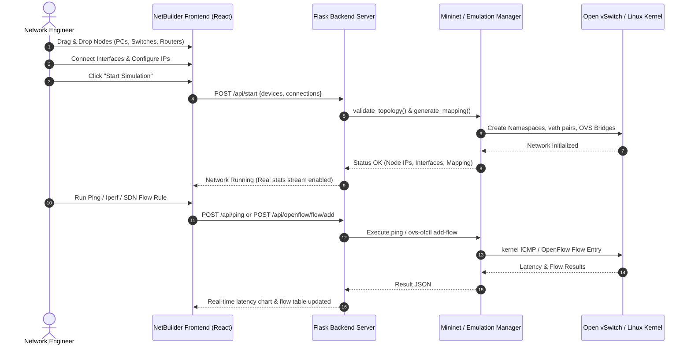

# NetBuilder — Interactive Software-Defined Network Emulator & Visual Topology Architect

<div align="center">


<p align="center">
  <b>A full-stack, browser-based network simulation and software-defined networking (SDN) platform powered by React 19, Flask, Mininet, and Open vSwitch.</b>
  <br />
  <i>Design complex network topologies with drag-and-drop ease, inject Linux Traffic Control QoS impairments, program custom OpenFlow switch rules, inspect live packet captures with tcpdump, and execute commands via interactive node terminals.</i>
</p>

[Key Features](#-key-features) • [System Architecture](#-system-architecture) • [Tech Stack](#-technology-stack) • [Quick Start](#-quick-start-guide) • [API Reference](#-rest-api-reference) • [Walkthrough](#-step-by-step-walkthrough)

---

</div>

## 📌 Overview

**NetBuilder** bridges the gap between theoretical computer networking and practical SDN engineering. It provides an intuitive, high-performance web interface for building, visualizing, and stressing real or emulated computer networks.

### 🌟 Dual-Engine Simulation Architecture
NetBuilder operates seamlessly across two distinct operational modes:
1. **Native Mininet & Open vSwitch Engine (Linux / Root):**
   When run on a Linux host (or WSL2 / Docker / VM) with `sudo` privileges, NetBuilder creates genuine Linux network namespaces, Open vSwitch virtual bridges, and virtual ethernet pairs (`veth`). Traffic generated in tests is real kernel-space networking traffic.
2. **High-Fidelity Platform-Agnostic Mock Engine (Cross-Platform / Windows / macOS):**
   When run on Windows or developer environments without Mininet or root access, NetBuilder automatically shifts into an intelligent simulation engine. It generates realistic ping latencies, iperf bandwidth graphs, simulated OpenFlow flow tables, live tcpdump packet streams, and topology discovery trees without requiring external hypervisors.

---

## ⚡ Key Features

### 1. 🎨 Visual Drag-and-Drop Topology Canvas
- **Rich Network Devices:** Drag-and-drop Routers, Switches, PCs, Servers, Firewalls, and Hubs with automatic IP assignment (`10.0.x.x`).
- **Dynamic Connection Links:** Interactive SVG links connecting device interfaces with real-time animated packet traversal particles.
- **Visual Link State Monitoring:** Color-coded link states (Active green, Down red, Congested orange) with real-time throughput labels.
- **Pre-Built Network Templates:** Instant access to pre-configured templates such as *Basic LAN*, *Multi-Subnet Linux Router*, *Star Topology*, and *Mesh*.

### 2. 🔀 SDN OpenFlow Flow Programmer
- **Flow Table Inspection:** View real-time flow tables for every Open vSwitch instance in the network.
- **Rule Injection:** Program custom OpenFlow match-action rules (e.g., match `in_port`, `dl_type`, `nw_src`, `nw_dst`, `tp_dst` and assign actions such as `output`, `drop`, `normal`, or `mod_dl_dst`).
- **Priority Management:** Set custom flow priorities and test software-defined packet steering on the fly.

### 3. 💻 Interactive Node Terminal
- **Namespace Shell Access:** Open a web terminal session directly on any simulated host, switch, or router.
- **Command Execution:** Run real network utility commands:
  ```bash
  ifconfig -a
  ip route show
  ping -c 4 10.0.0.2
  curl -I http://10.0.0.3
  iptables -L -n -v
  ```
- Instant stdout/stderr streaming back to the browser.

### 4. 🚀 Performance Testing & Diagnostic Suite
- **Real ICMP Ping:** End-to-end latency measurement, min/avg/max/mdev RTT metrics, and packet loss tracking.
- **Real Iperf Bandwidth Benchmark:** True throughput measurement in Mbits/sec and Gbits/sec with customizable test durations.
- **Traffic Generator:** Continuous TCP and UDP stream generation for load testing and buffer analysis.
- **Dynamic Link State Failure Injection:** Simulate cable cuts by toggling link state `DOWN` and `UP` at runtime to observe routing and spanning-tree recovery.

### 5. 🎛️ Traffic Control (TC) & QoS Impairment
Fine-tune physical link characteristics with Linux `tc-netem`:
- **Bandwidth Throttling:** Restrict link bandwidth (e.g., 10 Mbps, 100 Mbps, 1 Gbps).
- **Latency / Delay:** Inject artificial propagation delay (e.g., 5ms, 50ms, 200ms).
- **Packet Loss:** Introduce probabilistic packet dropping (0% - 100%).
- **Queue Limits:** Configure maximum queue buffer sizes to observe packet drops under bufferbloat conditions.

### 6. 🔍 Live Packet Capture Engine (Web tcpdump & Wireshark Inspector)
- **Live Interface Capture:** Stream packet traces live from any node interface.
- **Berkeley Packet Filter (BPF):** Filter traffic on demand (e.g., `icmp`, `tcp port 80`, `arp`).
- **Deep Packet Inspection (DPI):** Detailed packet breakdown including timestamps, source/destination MAC, IP headers, protocol types, payload size, and hex dump.
- **Protocol Distribution Analytics:** Real-time percentage breakdowns of TCP, UDP, ICMP, ARP, and DNS traffic.
- **PCAP Export:** Export capture sessions for deeper analysis in desktop Wireshark.

### 7. 🗺️ Routing & Network Discovery
- **Shortest Path Computation:** Automatic Dijkstra path discovery between any source and destination node.
- **Hop-by-Hop Traceroute:** Live trace route detailing intermediate gateways and RTT per hop.
- **Linux Kernel Routing Table Management:** View active routing entries and inject dynamic routes (`ip route add/del`) through the UI.
- **Live Topology Discovery:** Automatic backend query identifying active nodes, MAC mappings, IP configurations, and switch link states.

### 8. 📊 Advanced Experimentation & Telemetry
- **Scenario Recording:** Record complete experiment runs including traffic patterns, link drops, and throughput fluctuations.
- **Experiment Replay:** Re-run historical experiments to verify reproducibility.
- **Side-by-Side Comparison:** Compare two experiment trials across throughput, packet loss, and latency charts using interactive Recharts.
- **Automated Health & Audit Reports:** Generate downloadable markdown and JSON reports summarizing topology architecture, interface states, and test outcomes.

---

## 🏗️ System Architecture

```
                      +-------------------------------------------------------+
                      |                 NETBUILDER CLIENT                     |
                      |          React 19 + Vite 7 + Tailwind v4              |
                      +-------------------------------------------------------+
                                 |                                 |
           REST API / JSON Calls |                                 | WebSocket / Events
                                 v                                 v
                      +-------------------------------------------------------+
                      |                 FLASK BACKEND SERVER                  |
                      |            backend/server.py (Port 5000)              |
                      +-------------------------------------------------------+
                         |           |               |              |
         +---------------+           |               |              +---------------+
         v                           v               v                              v
+------------------+   +-------------------+   +--------------------+   +---------------------+
| MininetManager   |   | ExperimentManager |   | CaptureManager     |   | StatsManager        |
| - Topology Build |   | - Telemetry Log   |   | - Live tcpdump     |   | - Host/Switch Stats |
| - Node Terminal  |   | - Replay Engine   |   | - BPF Filters      |   | - OpenFlow Tables   |
| - TC Link Config |   | - Comparison      |   | - PCAP Downloader  |   | - Flow Injection    |
+------------------+   +-------------------+   +--------------------+   +---------------------+
         |
         +-----------------------------------------------+
         |                                               |
         v [Linux / Root Environment]                    v [Windows / macOS / Dev Mode]
+------------------------------------+        +----------------------------------------+
| Real Kernel-Level Mininet Network  |        | High-Fidelity Network Emulation Engine |
| - Linux Network Namespaces         |        | - Synthetic Traffic Generation         |
| - Open vSwitch (OVS) Bridges       |        | - OpenFlow 1.3 State Tracker           |
| - Linux tc (traffic control)       |        | - Realistic Packet Capture Generator   |
| - Kernel veth pairs & routing      |        | - Dijkstra Path Calculator             |
+------------------------------------+        +----------------------------------------+
```

### Flow Lifecycle Diagram



---

## 🛠️ Technology Stack

### Frontend
| Component | Technology | Description |
|---|---|---|
| **Core Framework** | [React 19](https://react.dev/) | High-performance reactive UI with modern hooks and concurrent rendering |
| **Build Tool** | [Vite 7](https://vitejs.dev/) | Ultra-fast HMR and bundle optimization |
| **Styling** | [Tailwind CSS v4](https://tailwindcss.com/) | Modern utility-first CSS engine with modern color schemes |
| **UI Components** | [Radix UI](https://www.radix-ui.com/) + [Shadcn UI](https://ui.shadcn.com/) | Accessible, modular dialogs, sheets, tabs, tooltips, and dropdowns |
| **Icons** | [Lucide React](https://lucide.dev/) | Crisp, unified SVG iconography |
| **Charts & Metrics** | [Recharts](https://recharts.org/) | Responsive SVG time-series graphs for throughput, latency, and packet loss |
| **Notifications** | [Sonner](https://sonner.emilkowal.ski/) | Rich, non-intrusive toast notifications |
| **Routing** | [React Router v7](https://reactrouter.com/) | Client-side routing between Home, Simulator, and Contact pages |

### Backend
| Component | Technology | Description |
|---|---|---|
| **Web Server** | [Python 3.10+ Flask](https://flask.palletsprojects.com/) | RESTful API server handling network lifecycle commands |
| **CORS Middleware** | [Flask-CORS](https://flask-cors.readthedocs.io/) | Secure cross-origin resource sharing for frontend requests |
| **SDN Emulation** | [Mininet 2.3+](http://mininet.org/) | Creates realistic virtual networks running real kernel network stacks |
| **Virtual Switch** | [Open vSwitch (OVS)](https://www.openvswitch.org/) | Production-grade multilayer OpenFlow virtual switch |
| **QoS / Shaping** | Linux `tc` (Traffic Control) | Network emulation for bandwidth, latency, jitter, and loss |
| **Packet Inspection** | `tcpdump` / Raw Sockets | Packet sniffer and packet analyzer daemon |

---

## 📂 Project Structure

```
NetBuilder/
├── backend/                             # Python Flask Backend
│   ├── capture_manager.py               # Live tcpdump & simulated packet capture engine
│   ├── experiment_manager.py            # Experiment recording, replay, & comparison logic
│   ├── mininet_manager.py               # Core Mininet lifecycle, node CLI, and dual-mode engine
│   ├── requirements.txt                 # Backend Python dependencies
│   ├── server.py                        # Flask REST API endpoints and router definitions
│   ├── stats_manager.py                 # OpenFlow flow table parser and interface statistics
│   └── topology_manager.py              # Topology validation, graph search, and mapping generator
│
├── client/                              # React 19 + Vite Frontend
│   ├── public/                          # Static assets and icons
│   ├── src/
│   │   ├── components/
│   │   │   ├── blocks/                  # Navbar, Footer, Hero sections, and Dashboard items
│   │   │   ├── network/                 # Core network visualization components
│   │   │   │   ├── ConfigPanel.jsx      # Node & link property editor (IP, Subnet, TC settings)
│   │   │   │   ├── ConnectionLine.jsx   # Interactive SVG wires with dynamic status and flow dots
│   │   │   │   ├── DemoInstructions.jsx # User guide and quick hints
│   │   │   │   ├── DeviceNode.jsx       # Draggable canvas node representation
│   │   │   │   ├── DevicePanel.jsx      # Device palette (Router, Switch, PC, Server, etc.)
│   │   │   │   ├── NetworkCanvas.jsx    # Infinite interactive canvas grid with drag & select
│   │   │   │   ├── NodeTerminalModal.jsx# Terminal modal to execute bash commands on nodes
│   │   │   │   ├── SdnFlowProgrammer.jsx# OpenFlow flow rule editor and match/action injector
│   │   │   │   ├── SimulationControls.jsx# Full control panel (Tests, TC, Experiments, Capture)
│   │   │   │   ├── TutorialOverlay.jsx  # Interactive step-by-step onboarding walkthrough
│   │   │   │   └── WelcomeModal.jsx     # First-time user greeting modal
│   │   │   └── ui/                      # Shadcn / Radix UI component library
│   │   ├── config/                      # Navigation configurations
│   │   ├── data/
│   │   │   └── sampleNetworks.js        # Built-in network templates (Basic LAN, Multi-Subnet)
│   │   ├── hooks/
│   │   │   ├── use-mobile.js            # Responsive layout detection hook
│   │   │   └── useNetworkSimulation.js  # Main state machine hook for network operations
│   │   ├── lib/
│   │   │   ├── axios.js                 # Axios HTTP client configuration
│   │   │   ├── socket.js                # WebSocket client setup
│   │   │   └── utils.js                 # Helper utilities and Tailwind class merging (cn)
│   │   ├── pages/
│   │   │   ├── ContactUs.jsx            # Contact page
│   │   │   ├── Dashboard.jsx            # User dashboard
│   │   │   ├── Home.jsx                 # Modern landing page showcasing NetBuilder
│   │   │   └── NetworkSimulator.jsx     # Main workspace containing canvas and control dock
│   │   ├── App.jsx                      # App root router and theme wrappers
│   │   └── main.jsx                     # Vite React entry point
│   ├── package.json                     # Frontend dependencies and npm scripts
│   ├── tailwind.config.js               # Tailwind CSS theme extension
│   └── vite.config.js                   # Vite configuration with path aliases
│
├── .gitignore                           # Git ignore specification
└── README.md                            # Comprehensive project documentation
```

---

## 🚀 Quick Start Guide

### Prerequisites
- **Node.js**: `v18.0.0` or higher
- **Python**: `3.10` or higher
- **Git**

*(Optional for Native Linux Mininet Mode)*:
- Ubuntu 20.04/22.04 LTS or WSL2 (Ubuntu)
- `mininet` (`sudo apt-get install mininet openvswitch-switch tcpdump iperf iproute2`)

---

### Step 1: Clone the Repository
```bash
git clone https://github.com/Chethana45/NetBuilder.git
cd NetBuilder
```

---

### Step 2: Set Up & Start the Backend

1. Navigate to the backend directory:
   ```bash
   cd backend
   ```

2. Create and activate a Python virtual environment:
   ```bash
   # On Windows (PowerShell)
   python -m venv venv
   .\venv\Scripts\Activate.ps1

   # On Linux / macOS / WSL
   python3 -m venv venv
   source venv/bin/activate
   ```

3. Install required Python packages:
   ```bash
   pip install -r requirements.txt
   ```

4. Launch the Flask API server:
   ```bash
   # Standard / Simulated Mode (Windows, macOS, or Linux non-root):
   python server.py

   # Native Mininet Mode (Linux / WSL2 with Root):
   sudo mn -c          # Clean up any leftover Open vSwitch / Mininet sockets
   sudo $(which python3) server.py
   ```
   *The backend starts at `http://localhost:5000`.*

---

### Step 3: Set Up & Start the Frontend Client

1. Open a new terminal and navigate to the `client` directory:
   ```bash
   cd client
   ```

2. Install npm dependencies:
   ```bash
   npm install
   ```

3. Launch the Vite development server:
   ```bash
   npm run dev
   ```
   *The frontend starts at `http://localhost:5173`.*

4. Open your browser and navigate to `http://localhost:5173`. Click **"Open Simulator"** or navigate directly to `/network-simulator` to begin!

---

## 🔌 REST API Reference

NetBuilder provides a comprehensive RESTful API exposed on port `5000`:

### Simulation & Network Lifecycle
| Method | Endpoint | Description | Sample Request Body |
|---|---|---|---|
| `GET` | `/api/health` | Check environment status (Mininet, OVS, root permissions) | *None* |
| `POST` | `/api/start` | Build & launch network topology from devices and links | `{"devices": [...], "connections": [...]}` |
| `POST` | `/api/stop` | Stop active network simulation cleanly | *None* |
| `POST` | `/api/reset` | Terminate processes and clean OVS/Mininet state | *None* |
| `GET` | `/api/topology` | Fetch active topology details, nodes, and device counts | *None* |
| `GET` | `/api/discovery`| Probe live network to discover interfaces, IPs, and switches | *None* |

### Performance Testing & Impairment
| Method | Endpoint | Description | Sample Request Body |
|---|---|---|---|
| `POST` | `/api/ping` | Execute ICMP ping between two nodes | `{"source": "pc-001", "target": "pc-002"}` |
| `POST` | `/api/iperf` | Run TCP/UDP bandwidth throughput test | `{"source": "pc-001", "target": "pc-002", "duration": 5}` |
| `POST` | `/api/traffic`| Generate continuous TCP/UDP test traffic | `{"source": "pc-001", "target": "pc-002", "protocol": "TCP", "duration": 10}` |
| `POST` | `/api/link/down`| Simulate physical link failure (cable disconnect) | `{"source": "switch-1", "target": "pc-001"}` |
| `POST` | `/api/link/up` | Restore a severed link | `{"source": "switch-1", "target": "pc-001"}` |
| `POST` | `/api/link/config`| Apply Linux TC QoS parameters (bandwidth, latency, loss, queue) | `{"source": "s1", "target": "s2", "bw": 50, "delay": "20ms", "loss": 5, "queue": 100}` |

### SDN & OpenFlow Control
| Method | Endpoint | Description | Sample Request Body |
|---|---|---|---|
| `GET` | `/api/switches` | List all switches with port stats, DPIDs, and active flows | *None* |
| `GET` | `/api/switch/<id>` | Fetch detailed telemetry for an individual switch | *None* |
| `GET` | `/api/flows` | Retrieve raw OpenFlow flow tables from OVS bridges | *None* |
| `GET` | `/api/flows/parsed`| Retrieve structured JSON representation of OpenFlow rules | *None* |
| `POST` | `/api/openflow/flow/add` | Program a custom OpenFlow match/action rule | `{"switch_id": "s1", "match": "ip,nw_dst=10.0.0.2", "actions": "output:2", "priority": 150}` |

### Packet Capture Engine
| Method | Endpoint | Description | Sample Request Body |
|---|---|---|---|
| `POST` | `/api/capture/start` | Start live packet capture daemon on a node | `{"node_id": "pc-001", "interface": "eth0", "filter": "tcp"}` |
| `POST` | `/api/capture/stop` | Stop packet capture daemon on a node | `{"node_id": "pc-001"}` |
| `GET` | `/api/capture/packets?node_id=X&limit=100` | Fetch parsed packet buffer for a node | *Query param `node_id`* |
| `POST` | `/api/capture/clear` | Clear captured packet history | `{"node_id": "pc-001"}` |
| `GET` | `/api/capture/<id>/analysis` | Retrieve protocol distribution statistics | *URL parameter `node_id`* |
| `GET` | `/api/capture/<id>/pcap` | Download capture buffer formatted as PCAP | *URL parameter `node_id`* |

### Diagnostics, Routing & Terminal
| Method | Endpoint | Description | Sample Request Body |
|---|---|---|---|
| `POST` | `/api/node/cmd` | Execute arbitrary bash command inside node namespace | `{"node_id": "h1", "command": "ip route show"}` |
| `POST` | `/api/traceroute` | Run hop-by-hop traceroute between nodes | `{"source": "pc-001", "target": "server-001"}` |
| `GET` | `/api/router/routes?node_id=X` | Read node routing table entries | *Query param `node_id`* |
| `POST` | `/api/router/route/add` | Inject a static route into a node | `{"node_id": "r1", "destination": "10.0.2.0/24", "gateway": "10.0.1.2", "interface": "eth1"}` |
| `POST` | `/api/diagnostics` | Trigger automated network health checks | *None* |
| `POST` | `/api/reports/generate`| Generate complete audit test report | *None* |

### Advanced Experiments
| Method | Endpoint | Description | Sample Request Body |
|---|---|---|---|
| `POST` | `/api/experiments/start`| Begin telemetry recording for an experiment | `{"name": "DDoS Test", "duration": 60}` |
| `POST` | `/api/experiments/stop` | End active experiment session | *None* |
| `GET` | `/api/experiments/active`| Get live metric telemetry for current run | *None* |
| `GET` | `/api/experiments/history`| List historical experiment sessions | *None* |
| `POST` | `/api/experiments/<id>/replay`| Re-run an experiment scenario | *URL parameter `exp_id`* |
| `POST` | `/api/experiments/compare`| Compare two runs side-by-side | `{"exp1": "exp_001", "exp2": "exp_002"}` |

---

## 📖 Step-by-Step Walkthrough

### 1. Building a Topology
1. Click the **Device Panel** on the left dock.
2. Drag a **Router**, a **Switch**, and two **PCs** onto the canvas.
3. Hover over a device's connection port and drag a wire to connect to another device.
4. Click on any device to open the **Config Panel** to customize its IP, Subnet Mask, Gateway, or port count.

### 2. Launching the Network
1. Click the **Start Network** button in the bottom dock.
2. The canvas enters the active running state. Devices show operational statuses, and interface IP labels appear.

### 3. Testing Connectivity & Bandwidth
1. Under **Simulation Controls**, navigate to the **Testing** tab.
2. Select **Source** as `PC-1` and **Target** as `PC-2`.
3. Click **Ping Test**: Observe real-time ICMP round-trip times and packet animation traverse the wires.
4. Click **Iperf Bandwidth**: Measure true link throughput in Mbits/sec.

### 4. Simulating Network Impairments (QoS / TC)
1. Navigate to the **Traffic Control** tab in Simulation Controls.
2. Select the connection link between your Switch and Router.
3. Adjust **Delay** to `50ms` and **Packet Loss** to `10%`. Click **Apply Link Conditions**.
4. Re-run the Ping Test: Observe the measured latency increase by exactly 50ms and notice the packet loss rate reflected in the telemetry graph.

### 5. Programming OpenFlow SDN Rules
1. Navigate to the **SDN Flows** tab or click **SDN Flow Programmer**.
2. Select target switch `s1`.
3. Enter Match Criteria (e.g., `ip,nw_dst=10.0.0.3`) and Action (e.g., `drop` to simulate a firewall rule or `output:2`).
4. Set Priority to `200` and click **Add Rule**.
5. Test connectivity: Traffic matching the rule will immediately be dropped or rerouted by Open vSwitch!

### 6. Interactive Node Shell & Wireshark Capture
1. Select any device and click **Open Terminal**.
2. Type `ifconfig` or `ip route show` to view the kernel-level network configuration.
3. Open the **Packet Capture** tab, pick an interface, and click **Start Capture**.
4. Send a ping packet from another node to view the live TCP/ICMP packet headers streaming in the browser table in real time.

---

## 🛡️ Security & Production Considerations

- **Mininet Root Isolation:** On native Linux systems, running Mininet requires root privileges due to kernel network namespace and Open vSwitch bridge creation. It is recommended to run native Mininet inside a dedicated Linux VM, Docker container, or WSL2 instance rather than directly on shared production servers.
- **Node Terminal Command Sanitization:** In non-root simulation mode, command inputs are handled within safe mock sandboxes. For production deployments, ensure API endpoints are bound to `127.0.0.1` or protected behind authentication middleware.

---

## 🤝 Contributing

Contributions to NetBuilder are welcome! Whether you are improving OpenFlow rule presets, adding new networking device types, optimizing the canvas rendering, or expanding protocol analysis:

1. Fork the Project: `https://github.com/Chethana45/NetBuilder.git`
2. Create your Feature Branch: `git checkout -b feature/AmazingFeature`
3. Commit your Changes: `git commit -m 'Add AmazingFeature'`
4. Push to the Branch: `git push origin feature/AmazingFeature`
5. Open a Pull Request

---

## 📄 License

Distributed under the MIT License. See `LICENSE` for more information.

---

<div align="center">
  <b>Built with ❤️ by <a href="https://github.com/Chethana45">Chethana45</a></b>
  <br />
  <sub>Next-Generation Interactive Computer Networking & SDN Emulation</sub>
</div>
